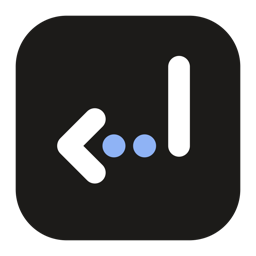
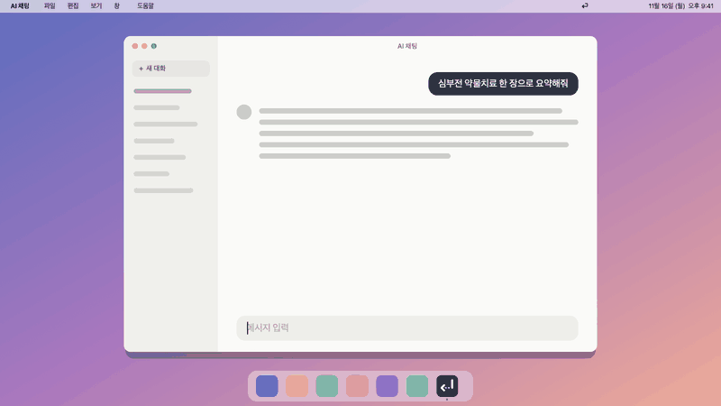
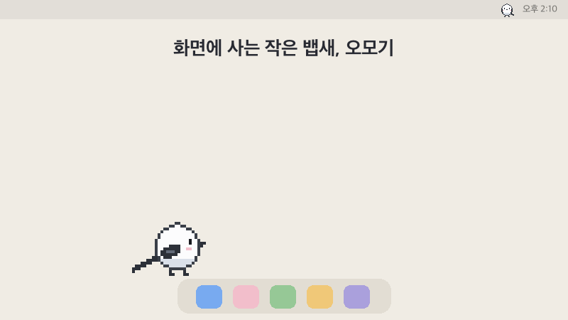
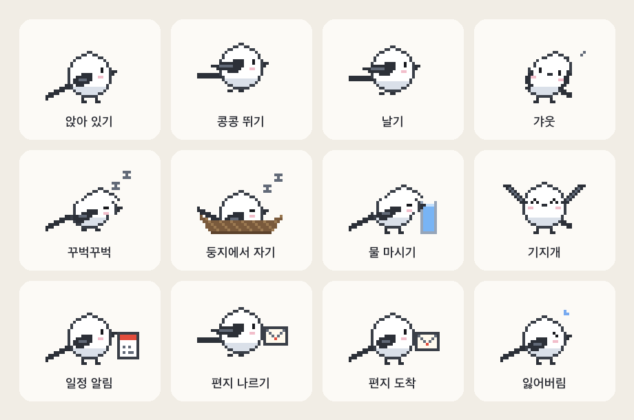

<p align="center">
  
</p>

<h1 align="center">Loading Dose</h1>

<p align="center">
  <b>로딩 중에 한 문제씩.</b><br>
  Claude나 ChatGPT의 답을 기다리는 몇 초 동안 국시 O/X 문제를 띄워 줍니다.
</p>

<p align="center">
  <a href="https://github.com/Yunseong-Ko/loading-dose/releases/latest"><b>내려받기 (Mac 앱 · 크롬 확장)</b></a>
  &nbsp;·&nbsp;
  <a href="assets/demo.mp4">영상으로 보기 (MP4)</a>
</p>

<p align="center">
  
</p>

Claude나 ChatGPT에 질문을 보내고 답을 기다리는 몇 초 동안, 화면 위에 의사 국가시험(KMLE) 대비 문제를 한 문항씩 띄워 주는 도구입니다. 답변이 도착하면 알아서 접힙니다.

위 영상은 동작을 설명하려고 그린 시연이며 실제 화면 녹화가 아닙니다. 채팅 화면은 특정 서비스의 화면이 아닌 중립적인 그림입니다.

이름은 약리학의 부하 용량(loading dose)에서 땄습니다. 로딩 중에 한 문제씩 투여합니다.

- **Mac 앱**: Claude·ChatGPT 데스크톱 앱에서 동작합니다. 메뉴 막대에 `⏎`로 상주하고, 앱을 열면 과목과 덱을 고르는 설정 창이 뜹니다.
- **크롬 확장**: claude.ai, chatgpt.com 에서 동작합니다.

테스트 버전입니다. Mac 앱은 Claude 데스크톱 앱에서 동작을 확인했고, ChatGPT 데스크톱 앱과 크롬 확장은 실제 사이트에서 아직 확인하지 못했습니다.

## 문제는 어디서 오나

| 소스 | 설명 | Mac 앱 | 크롬 확장 |
|---|---|---|---|
| 기본 제공 퀴즈 | 기초과목을 포함한 25개 과목 O/X 약 2,800문항 ([packs/kmle.txt](packs/kmle.txt)). 과목별로 켜고 끌 수 있습니다. | O | O |
| Anki 빈칸 카드 | 내 Anki의 Cloze 카드를 읽어 덱 단위로 시험범위를 고릅니다. Anki 원본은 바꾸지 않습니다. | 직접 읽기 | 내보내기 파일(.txt) 불러오기 |
| 정리본·강의록 | 붙여넣은 글이나 PDF로 Claude API가 O/X 문항을 만듭니다. 본인 API 키가 필요합니다. | O | 없음 |
| 직접 쓴 문제 | `문장 \| O 또는 X \| 해설` 형식의 텍스트 | O | O |

기본 제공 문항은 직접 만든 Anki 덱(Allen Cloze)을 바탕으로 AI가 새로 쓴 것이고, **사람이 검수하지 않았습니다.** 작업 중 원본 카드에서 발견된 의심 항목은 [packs/카드_확인_목록.md](packs/카드_확인_목록.md)에 있습니다.

## 설치

받는 사람용 안내는 [배포/설치방법.txt](배포/설치방법.txt)에 있습니다. 요약하면 다음과 같습니다.

**Mac 앱**

```bash
mac/build.sh
```

`mac/build/Loading Dose.app`이 만들어집니다. 응용 프로그램 폴더로 옮겨 실행한 뒤, 시스템 설정 → 개인정보 보호 및 보안 → 손쉬운 사용에서 켭니다. 이 권한으로 Enter 키 입력과 대상 앱의 "중지" 버튼을 읽어 답변 생성 중인지 판단합니다.

정식 개발자 서명이 없어서 다시 빌드하면 권한을 새로 켜야 합니다. 감지 기준만 바꿀 때는 빌드 대신 아래 설정 파일을 쓰세요.

**크롬 확장**

`chrome://extensions` → 개발자 모드 → "압축해제된 확장 프로그램을 로드합니다"에서 이 폴더를 선택합니다.

## 폴더 구성

```
manifest.json, content.js, cards.js, options.*   크롬 확장
pack.js                                          기본 제공 퀴즈 (packs/kmle.txt 에서 생성)
mac/main.swift, mac/build.sh                     Mac 앱 (AppKit, 외부 의존성 없음)
mac/quiz.swift                                   문항·카드 화면·로딩 감지 (Loading Dose 와 Omogi 공용)
omogi/                                           Omogi — 따로 나온 펫 앱 (아래 설명)
packs/kmle.txt                                   기본 제공 퀴즈 원본
packs/parts/                                     과목별 문항 파일
tools/merge_pack.py                              parts → kmle.txt (형식·중복 검사)
tools/build_pack.py                              kmle.txt → pack.js
test.html                                        크롬 확장 카드 동작을 보는 가짜 채팅 페이지
배포/                                             배포용 설치 안내 (압축 파일은 저장소에 넣지 않음)
assets/                                          README용 아이콘과 시연 영상 (tools/demo_video.swift 로 생성)
```

문항을 고친 뒤에는 `tools/merge_pack.py`, `tools/build_pack.py`, `mac/build.sh` 순서로 실행합니다.

## Omogi (펫 앱)

<p align="center">
  
</p>

<p align="center">
  <a href="https://github.com/Yunseong-Ko/loading-dose/releases/tag/omogi-v0.3.0"><b>Omogi 내려받기 (Mac · Windows)</b></a>
  &nbsp;·&nbsp;
  <a href="assets/omogi-teaser.mp4">티저 영상 (음악 포함, MP4)</a>
  &nbsp;·&nbsp;
  <a href="assets/omogi-demo.mp4">소개 영상 (MP4)</a>
</p>

`omogi/` 는 Loading Dose 와 별개인 Mac 메뉴 막대 앱입니다. 화면 아래에 흰오목눈이 "오모기"가 살면서 돌아다니고, 졸고, 둥지를 짓습니다.

- 집중 모드: 브라우저에서 유튜브·인스타그램을 열면 오모기가 날아가 탭을 닫습니다 (손쉬운 사용 권한 필요, 기본 꺼짐).
- 습관 알림: 물 마시기, 눈 쉬기, 스트레칭을 때맞춰 알려 줍니다.
- 일정 알림: Mac 캘린더 일정이 시작하기 10분 전에 알려 줍니다 (캘린더 접근 필요, 기본 꺼짐).
- 편지 (만드는 중): 쪽지를 쓰면 오모기가 물고 날아가 30분~3시간 뒤에 전하고, 가끔은 잃어버립니다. 아이디나 친구 코드로 친구를 맺어 주고받으며, 내용은 받는 사람만 열 수 있게 잠가서 보냅니다. 서버는 Supabase (`omogi/server/schema.sql`, 주소와 공개용 키는 `omogi/server.json`), 없으면 나에게 보내는 연습 배달만 됩니다.
- 설정: Omogi 앱을 다시 열면 설정 창이 뜨고, 화면의 오모기를 오른쪽 클릭해도 메뉴가 나옵니다 (메뉴 막대 아이콘이 가려진 Mac 용).
- O/X 퀴즈: Loading Dose 와 같은 문항으로, 오모기가 가끔 문제를 물어 오거나 Claude·ChatGPT 앱의 답변을 기다리는 동안 카드가 뜹니다 (기본 꺼짐, `omogi/quizwatch.swift`).
- 꼬마 뱁새와 옷장: O/X 를 맞히면 꼬마 뱁새가 모이고(5연속으로 터지면 흩어지는 꼬마를 눌러 잡는다), 그것으로 모자·안경·목도리 같은 옷을 사서 입힙니다. 옷 그림은 `tools/make_pet_sprites.py` 가 자세마다 만들어 `omogi/pet/wear.png` 에 넣습니다. 내 컴퓨터에만 저장됩니다.
- Windows 판(테스트 0.2.0): `omogi/windows/` (C# WinForms). GitHub Actions 가 빌드하고 자체 점검을 돌립니다. 집중 모드와 일정 알림은 아직 없고, Mac 친구와 편지를 주고받을 수 있습니다.
- 빌드: `omogi/build.sh` → `omogi/build/Omogi.app`. 조정은 `~/Library/Application Support/Omogi/config.json`.

<p align="center">
  
</p>

제작자: @hi20010205

위 영상과 그림은 앱과 같은 스프라이트로 그린 것입니다 (`tools/make_omogi_demo.py`, 화면 녹화가 아닙니다).

Loading Dose 는 `omogi/pet.swift` 를 같이 써서, 카드가 떠 있는 동안에만 오모기가 카드 옆에 나타나 정답·오답에 반응합니다.

## Mac 앱 조정과 진단

파일은 `~/Library/Application Support/Enter/`에 있습니다. (폴더·실행 파일·번들 ID는 예전 이름 Enter를 그대로 씁니다. 바꾸면 권한과 기록이 끊깁니다.)

- `config.json`: 감지 기준. 없으면 기본값을 씁니다.

  ```json
  {
    "targets": ["com.anthropic.claudefordesktop", "com.openai.chat"],
    "stopWords": ["stop", "중지", "정지", "중단"],
    "stopExclude": [],
    "pendingTimeout": 6,
    "endGrace": 1.5
  }
  ```

- `debug.log`: Enter를 잡았는지, "중지" 버튼을 찾았는지 남기는 진단 기록. 대화 내용은 적지 않습니다.
- `cards.txt`: 직접 쓴 문제와 AI로 만든 문제.
- `anki.tsv`: Anki에서 가져온 빈칸 카드.

## 알려진 한계

- Mac 앱은 Enter로 보낼 때만 카드가 뜹니다. 전송 버튼 클릭은 감지하지 않습니다.
- 크롬 확장은 사이트가 화면 구조를 바꾸면 감지가 깨질 수 있습니다. 기준은 `content.js`의 `SITE_SELECTORS`에 모여 있습니다.
- AI 출제는 요청 형식만 가짜 서버로 검사했고, 실제 Claude API 호출은 아직 해 보지 못했습니다.
- Windows 데스크톱 앱용은 없습니다.
